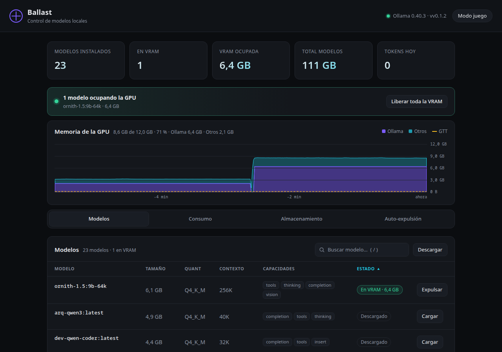
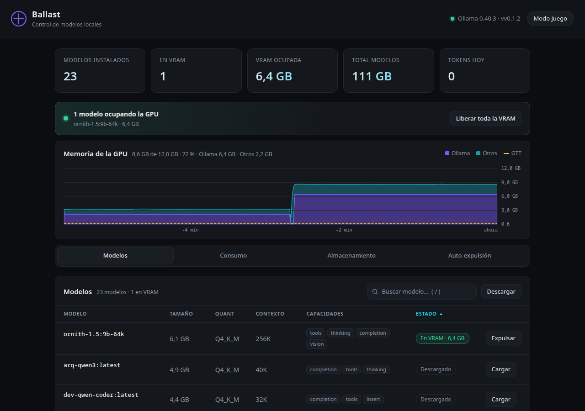
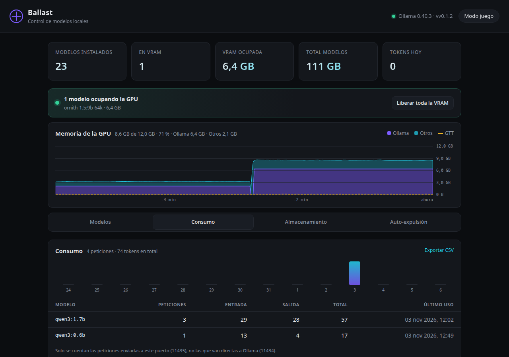
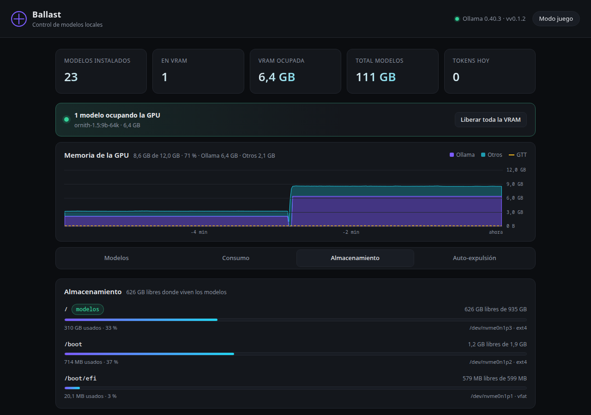
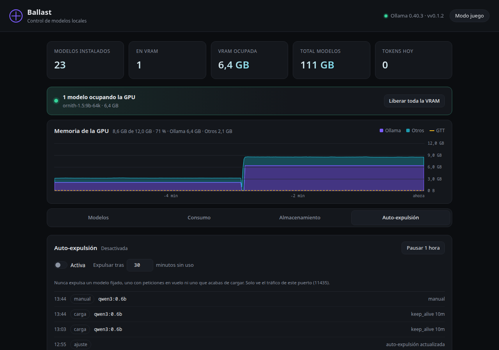

# Ballast

[](https://github.com/4M4L4K4Ky/Ballast/releases)
[](LICENSE)
[](https://go.dev)

Dashboard local para [Ollama](https://ollama.com): ve tus modelos, expúlsalos de
la VRAM con un clic, mira la memoria real de la GPU en vivo y contabiliza los
tokens que gastas con cada modelo.

Un solo binario. Sin Node, sin Python, sin contenedores, sin telemetría.

```
go build -o ballast ./cmd/ballast
./ballast
# abre http://127.0.0.1:11435
```

## Qué hace

- **Modelos**: lista con tamaño, cuantización, contexto y capacidades; buscador,
  ordenación y ficha completa (familia, arquitectura, capas, digest…).
- **VRAM**: qué está cargado, cuánto ocupa, cuándo se libera solo, botón
  **Expulsar** por modelo y **Liberar toda la VRAM** de golpe.
- **Memoria real de la GPU**: gráfica en vivo de 15 minutos con lo que ocupa
  Ollama y lo que ocupa el resto del sistema, leído de sysfs. Sin `radeontop`.
- **Auto-expulsión**: expulsa lo que lleva N minutos sin uso, pero nunca un
  modelo fijado, uno con peticiones en vuelo ni uno recién cargado. Pausa de
  1 hora y registro de lo que ha hecho.
- **Modo juego**: libera la GPU y bloquea las cargas desde Ballast hasta que lo
  desactives.
- **Almacenamiento**: espacio total, usado y libre de cada disco, con el de los
  modelos marcado y aviso si queda poco.
- **Descargas**: botón Descargar con barra de progreso agregada y cancelación
  limpia a mitad.
- **Consumo**: proxy en `:11435` que cuenta tokens de entrada y salida por
  modelo, gráfica de 14 días y exportación a CSV.
- **Interfaz por pestañas**: Resumen siempre visible; Modelos, Consumo,
  Almacenamiento y Auto-expulsión en pestañas. Tema oscuro/claro automático.

## Capturas

| Resumen | Modelos |
|---|---|
|  |  |

| Consumo | Almacenamiento | Auto-expulsión |
|---|---|---|
|  |  |  |

## El puerto importa

Ballast escucha en **11435** y reenvía todo lo que no es su propia API a Ollama
en **11434**. Para que el contador de tokens vea algo, tus clientes tienen que
apuntar a `http://127.0.0.1:11435`:

```sh
export OLLAMA_HOST=http://127.0.0.1:11435
```

Si van directos a `11434`, funcionan igual pero Ballast no los cuenta.

## Estado

Versión publicada (`v0.1.2`): fases 1–4 funcionan a diario.

| Fase | Contenido | Estado |
|---|---|---|
| F1 | Métricas del sistema (VRAM real, discos) | Hecho |
| F2 | Persistencia y descargas con progreso | Hecho |
| F3 | Proxy y contador de tokens | Hecho |
| F4 | Auto-expulsión segura | Hecho |
| F5 | Releases multiplataforma, `install.sh`, Docker | En curso |
| F6 | Catálogo y búsqueda online | Aplazado |

## Instalación

```sh
curl -fsSL https://raw.githubusercontent.com/4M4L4K4Ky/Ballast/main/install.sh | sh
```

Deja el binario en `~/.local/bin/ballast`.

## Uso

```
ballast [flags]

  --listen  dirección de escucha        (por defecto 127.0.0.1:11435)
  --ollama  URL de Ollama               (por defecto http://127.0.0.1:11434)
  --version muestra la versión y sale
```

Variables de entorno equivalentes: `BALLAST_LISTEN`, `BALLAST_OLLAMA_URL`.

Datos en `~/.local/share/ballast/` (o `BALLAST_DATA_DIR`): `ballast.db` con el
histórico de consumo y `state.json` con el modo juego.

## Cómo está hecho

- **Go** con la biblioteca estándar. Binario estático de ~12 MB, sin CGO.
- **SQLite en Go puro** (`modernc.org/sqlite`), la única dependencia externa.
- **HTML + CSS + JavaScript** sin framework ni paso de build. Todo va embebido
  con `embed.FS`.
- Pensado para no estorbar: si Ballast se cae, Ollama y tus clientes siguen
  funcionando igual.

## Desarrollo

```sh
make build     # binario en bin/ballast
make run       # compila y arranca en :11435
make cross     # binarios para linux/darwin/windows × amd64/arm64
make vet test
```

La especificación completa, con modelo de datos, API y criterios de aceptación,
está en [SPEC.md](SPEC.md). El reparto en tareas para los agentes locales está en
[PLAN.md](PLAN.md).

## Licencia

MIT.
